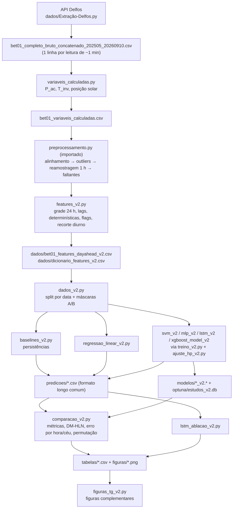

# Pipeline v2 — previsão day-ahead de P_ac (usina bet01)

Este documento descreve, etapa por etapa, o pipeline completo que gera os resultados da v2:
dos dados brutos de 1 minuto até as tabelas, os testes estatísticos e as figuras finais. Ele
explica **o que** cada script faz, **com que entradas e saídas**, **em que ordem** os scripts
rodam e **por que** cada escolha foi feita.

Documentos relacionados:
- `registro_mudancas_v2.md` (nesta pasta): o que mudou da v1 para a v2 (M1 a M17) e por quê.
- `PROXIMOS_PASSOS.md` (raiz do repositório): leitura dos resultados e pendências do texto.
- `diagnostico/fase0_saida_console_v2.txt`: achados do diagnóstico da v1 (Fase 0 §1 a §7).

---

## Sumário

1. [O problema de previsão](#1-o-problema-de-previsão)
2. [Visão geral e ordem de execução](#2-visão-geral-e-ordem-de-execução)
3. [Etapa 0: dados brutos](#3-etapa-0-dados-brutos)
4. [Etapa 1: variáveis calculadas por leitura](#4-etapa-1-variáveis-calculadas-por-leitura-de-1-min)
5. [Etapa 2: pré-processamento para a grade horária](#5-etapa-2-pré-processamento-para-a-grade-horária)
6. [Etapa 3: engenharia de features](#6-etapa-3-engenharia-de-features-features_v2py)
7. [Etapa 4: carregamento, split e máscaras](#7-etapa-4-carregamento-split-e-máscaras-dados_v2py)
8. [Etapa 5: modelos de referência](#8-etapa-5-modelos-de-referência)
9. [Etapa 6: ajuste de hiperparâmetros](#9-etapa-6-ajuste-de-hiperparâmetros-ajuste_hp_v2py)
10. [Etapa 7: treino dos modelos de ML](#10-etapa-7-treino-dos-modelos-de-ml-treino_v2py--modelos)
11. [Etapa 8: comparação e análises](#11-etapa-8-comparação-e-análises-comparacao_v2py)
12. [Etapa 9: ablação da LSTM](#12-etapa-9-ablação-da-lstm-modeloslstm_ablacao_v2py)
13. [Etapa 10: figuras complementares](#13-etapa-10-figuras-complementares-figuras_tg_v2py)
14. [Resultados principais](#14-resultados-principais)
15. [Garantias de reprodutibilidade e de não vazamento](#15-garantias-de-reprodutibilidade-e-de-não-vazamento)
16. [Como rodar](#16-como-rodar)
17. [Limitações conhecidas](#17-limitações-conhecidas)
18. [Mapa de arquivos](#18-mapa-de-arquivos)

---

## 1. O problema de previsão

- **Alvo:** `P_ac`, a potência CA média horária da usina bet01 (soma dos 10 inversores), em kW.
  A capacidade instalada é de 2.500 kWp (`dados.py:CAPACIDADE_KWP`).
- **Horizonte:** day-ahead. Prevê-se cada hora diurna do dia D+1 com informação disponível até
  o fim do dia D.
- **Emissão:** os lags "mesma hora, d dias antes" usam dados de D até 17h59 (a última hora
  diurna). Na prática, a previsão de D+1 é emitida depois de ~18h de D (Fase 0 §7).
- **Esquema:** um **único modelo** para todas as horas de D+1. A hora do dia entra como feature
  (posição solar e calendário); não há um modelo por horizonte.
- **Abordagem:** endógena e direta. Não há previsão meteorológica numérica (NWP) de D+1 como
  entrada; o modelo vê só o histórico medido da usina e grandezas determinísticas (geometria
  solar e calendário). A potência é prevista diretamente, sem a etapa irradiância → potência.
- **Período:** dados de 02/05/2025 a 10/09/2026. Treino até 31/07/2026; teste de 01/08 a
  10/09/2026 (41 dias, 491 horas).

---

## 2. Visão geral e ordem de execução



Ordem de execução (cada passo depende dos anteriores):

| # | Script | Lê | Grava |
|---|---|---|---|
| 0 | `dados/Extração-Delfos.py` | API Delfos | bruto de 1 min (CSV concatenado na raiz) |
| 1 | `dataset/formando_dataset/variaveis_calculadas.py` | bruto de 1 min | `bet01_variaveis_calculadas.csv` |
| — | `dataset/formando_dataset/preprocessamento.py` | (biblioteca, importada) | — |
| 2 | `código/features_v2.py` | `bet01_variaveis_calculadas.csv` | `dados/bet01_features_dayahead_v2.csv`, `dados/dicionario_features_v2.csv` |
| 3 | `código/dados_v2.py` | CSVs de `dados/` | nada (só confere e imprime o resumo) |
| 4 | `código/baselines_v2.py` | dataset v2 | `predicoes/predicoes_persistencias_v2.csv` |
| 5 | `código/modelos/regressao_linear_v2.py` | dataset v2 | previsões, `.joblib`, resumo JSON |
| 6 | `código/modelos/svm_v2.py`, `mlp_v2.py`, `lstm_v2.py`, `xgboost_model_v2.py` | dataset v2 | previsões, modelos por semente, resumo JSON, estudo Optuna |
| 7 | `código/comparacao_v2.py` | previsões + modelos salvos | `tabelas/*_v2.csv`, 4 figuras |
| 8 | `código/modelos/lstm_ablacao_v2.py` | resumo e previsões da LSTM | previsões, tabelas e resumo da ablação |
| 9 | `código/figuras_tg_v2.py` | tabelas, previsões e resumos | 5 figuras complementares |

O diagnóstico `diagnostico/diagnostico_fase0_v2.py` não faz parte do fluxo de produção: é uma
leitura do pipeline v1 cujos achados (Fase 0 §1 a §7) motivaram as decisões D1 a D8 da v2.

Todos os caminhos das tabelas acima, salvo indicação, são relativos a `código/resultados_v2/`.

---

## 3. Etapa 0: dados brutos

- **Origem:** plataforma de monitoramento Delfos. O script `dados/Extração-Delfos.py` consulta a
  API (`/solar-data/data-studio/device-types/2/timeseries`) em lotes, padroniza os nomes das
  colunas por usina (ex.: potência de cada inversor → `pot_inversor_01` a `pot_inversor_10`) e
  registra tudo em log. As credenciais ficam em `dados/config_delfos.yaml` (ver a nota de
  segurança na Seção 17).
- **Arquivo de entrada do pipeline:** `bet01_completo_bruto_concatenado_202505_20260910.csv`
  (raiz do repositório, ~141 MB, fora do git). Uma linha por leitura de ~1 min, com:
  - `tempo` (hora local, sem fuso);
  - `pot_inversor_01` a `pot_inversor_10` (kW);
  - `INV_01_TEMPERATURA_INTERNA` a `INV_10_TEMPERATURA_INTERNA` (°C);
  - estação solarimétrica: `irradiacao_inclinada` (POA), `SOL_IRRADIACAO_HORIZONTAL` (GHI),
    `SOL_IRRADIACAO_REFLETIDA` (albedômetro), `SOL_TEMP_MODULO`;
  - meteorologia: `temp_ambiente`, `umidade_relativa`, `velocidade_vento`,
    `TRACKER_DIRECAO_VENTO`.
- A usina tem rastreadores (seguidores), o que importa para o céu claro (Seções 8 e 17).

---

## 4. Etapa 1: variáveis calculadas por leitura de 1 min

**Script:** `dataset/formando_dataset/variaveis_calculadas.py` (v1, intocado).
**Saída:** `dataset/formando_dataset/bet01_variaveis_calculadas.csv`.

Para cada leitura de 1 min:

| Coluna | Cálculo |
|---|---|
| `P_ac` | soma de `pot_inversor_01..10` (`min_count=1`: NaN só se todos faltarem) |
| `T_inv` | média das temperaturas internas dos 10 inversores |
| `elevacao_solar`, `zenite_solar`, `azimute_solar` | pvlib, timestamp localizado em America/Fortaleza |
| `hora_do_dia`, `dia_do_ano` | calendário do timestamp |
| demais | repassadas sem transformação |

Na v2, a posição solar e o calendário **não** são usados a partir deste arquivo: são recalculados
na Etapa 3, no ponto médio de cada hora (M2). Daqui a v2 aproveita `P_ac`, `T_inv` e as variáveis
medidas.

---

## 5. Etapa 2: pré-processamento para a grade horária

**Script:** `dataset/formando_dataset/preprocessamento.py` (v1, **importado sem alteração** pela
v2). São quatro etapas, aplicadas em ordem por `features_v2.construir_grade_horaria_completa()`:

1. **`etapa_alinhamento`:** lê o CSV, remove timestamps duplicados (mantém o primeiro), indexa por
   `tempo` e ordena.
2. **`etapa_outliers`** (nas leituras de 1 min):
   - `P_ac` limitado a [0; 2.500] kW (o máximo real de 1 min é 2.552 kW; 1,35% das leituras ficam
     acima);
   - irradiâncias: negativos → 0; valores > 2.000 W/m² → NaN (o sensor satura em ~6.553 quando
     falha à noite);
   - umidade limitada a [0; 100]%; vento com piso 0.
3. **`etapa_reamostragem`:** média horária (`resample("1h")`, rótulo = início do intervalo
   [h, h+1)). Uma hora com menos de 30 leituras de `P_ac` vira NaN (outage parcial enviesaria a
   média). O filtro de cobertura só vale para `P_ac`, porque vento e `T_inv` passaram a ser
   reportados a ~12 leituras/h a partir de 02/2026.
4. **`etapa_faltantes`:** interpolação linear no tempo com `limit=1`, só entre valores válidos
   (`limit_area="inside"`).
   - **Atenção:** com `limit=1`, o pandas preenche a **primeira hora de qualquer lacuna interna**,
     não só lacunas de 1 h (Fase 0 §1). Por isso a v2 marca essas horas como `alvo_imputado`
     (Seção 6.5).

A quinta etapa da v1, `etapa_recorte_diurno` (por irradiância medida), **não** é usada: a v2 recorta
pelas horas com elevação solar positiva, um critério astronômico (Seção 6.6).

Depois das etapas, as colunas são renomeadas (`SOL_IRRADIACAO_HORIZONTAL` →
`irradiacao_horizontal`, `SOL_IRRADIACAO_REFLETIDA` → `irradiacao_refletida`,
`TRACKER_DIRECAO_VENTO` → `direcao_vento`, `SOL_TEMP_MODULO` → `temp_modulo`) e a série é
reindexada para uma **grade horária completa de 24 h/dia**, incluindo a noite. A grade completa é
necessária para que os lags "mesma hora, d dias antes" sejam calculados corretamente.

---

## 6. Etapa 3: engenharia de features (`features_v2.py`)

**Saídas** (em `resultados_v2/dados/`):
- `bet01_features_dayahead_v2.csv`: 5.725 linhas × (alvo `P_ac` + 39 features + 2 flags);
- `dicionario_features_v2.csv`: uma linha por feature, com nome, grupo, descrição, unidade, tipo
  (`lag` ou `deterministica`), variável de origem e defasagem em dias.

### 6.1 Lags "mesma hora, d dias antes" (32 features)

Para cada variável de `VARS_LAG` (herdada da v1, decisão D1):

| Variável | Grupo | Unidade |
|---|---|---|
| `P_ac` | potência CA da usina | kW |
| `temp_ambiente` | temperatura ambiente | °C |
| `umidade_relativa` | umidade relativa | % |
| `velocidade_vento` | velocidade do vento | m/s |
| `irradiacao_inclinada` | irradiância no plano dos módulos (POA) | W/m² |
| `irradiacao_horizontal` | irradiância global horizontal (GHI) | W/m² |
| `irradiacao_refletida` | irradiância refletida | W/m² |
| `T_inv` | temperatura interna média dos inversores | °C |

e para cada defasagem d ∈ {1, 2, 3, 7} dias, cria `{var}_lag{d}d`.

**Como:** a série é pivotada numa matriz data × hora; o deslocamento é feito no eixo das datas
(`pivot.shift(d)`) e a matriz é empilhada de volta. Assim, `P_ac_lag1d` da linha (D+1, 10h) é
exatamente `P_ac` de (D, 10h). Isso é robusto à duração do dia variar com a estação, ao contrário
de um `shift` posicional sobre as linhas diurnas.

Ficaram de fora: `temp_modulo` (r = 0,92 com a POA) e `direcao_vento` (~57% de faltantes).
Nenhum par de variáveis de `VARS_LAG` tem |r| ≥ 0,95 no lag de 1 dia (máximo 0,93, temperatura ×
umidade).

**Removidas em relação à v1 (M1):** as médias móveis `{var}_media3d` (combinação linear exata dos
lags 1 a 3) e `{var}_media7d` (VIF > 100). A v1 tinha 55 features; a v2 tem 39.

### 6.2 Features determinísticas do horário-alvo (7 features)

Calculadas **só a partir do timestamp**, no **ponto médio da hora** (h:30), com o instante
localizado em America/Fortaleza e pvlib (NREL SPA, `method="nrel_numpy"`), LAT/LON de `dados.py`:

| Feature | Grupo | Definição |
|---|---|---|
| `elevacao_solar` | posicao_solar | elevação solar aparente (°) |
| `azimute_sin`, `azimute_cos` | posicao_solar | seno e cosseno do azimute (0° = norte, sentido horário) |
| `hora_sin`, `hora_cos` | calendario | hora decimal (h + 0,5) codificada em ciclo de 24 h |
| `dia_ano_sin`, `dia_ano_cos` | calendario | dia do ano codificado em ciclo de 365,25 d |

Por que assim (M2 a M4):
- na v1, essas grandezas eram médias horárias dos valores de 1 min. A média do azimute quebrava
  na passagem 0°/360° (362 linhas com ≈180° em vez de ≈0°), e horas sem leitura recebiam posição
  solar interpolada (erro de até 23,6°);
- o azimute é circular: em seno/cosseno não há salto artificial de 360° para SVR, MLP e LSTM;
- o zênite foi removido porque `elevação + zênite = 90°` (colinearidade exata).

### 6.3 Ordem final das colunas

`P_ac` (alvo) → 7 determinísticas → 32 lags (8 variáveis × 4 defasagens) → `alvo_imputado`,
`evento_operacional`. A ordem das features é a do dicionário; `dados_v2.colunas_features()` a lê
de lá.

### 6.4 Coluna `evento_operacional` (M7, decisão D2)

Marca horas de **falha operacional** da usina (ex.: os 10 inversores em 0 kW com irradiância alta,
como em 07/09/2026, das 6h às 9h25), que não são previsíveis com as features disponíveis.

Com o PR horário definido como `PR = P_ac / (2500 · G_poa / 1000)`:
- **núcleo:** hora diurna com `G_poa > 200 W/m²` e `PR < 0,3`;
- **expansão:** hora vizinha (±1 h, no mesmo dia) de uma hora-núcleo com `G_poa > 50 W/m²` e
  `PR < 0,7` (captura o início e o fim do evento dentro da hora).

Os limiares são constantes no topo de `features_v2.py`. Resultado: 377 linhas (núcleo 303 +
expansão 74; 370 no treino, 7 no teste).

### 6.5 Coluna `alvo_imputado` (M6, decisão D3)

Verdadeira quando o `P_ac` da hora-alvo estava ausente **depois** da reamostragem e **antes** de
`etapa_faltantes`, ou seja, quando foi interpolado. São 2 linhas, ambas no treino (ex.:
20/10/2025 10h, sem nenhuma leitura, recebeu 1.442 kW interpolados).

Os valores imputados **continuam** alimentando os lags das linhas seguintes (um previsor em
operação também veria a série preenchida); só a linha-alvo é marcada.

> As duas flags usam dado **medido em D+1**. Servem exclusivamente para filtrar treino e
> avaliação e **nunca** entram como feature. `dados_v2.colunas_features()` aborta se alguma delas
> aparecer no dicionário.

### 6.6 Recorte diurno e descarte (M5)

1. Ficam só as linhas com `elevacao_solar` (no h:30) > 0: critério astronômico, sem seleção por
   dado medido de D+1.
2. São descartadas as linhas com alvo ausente ou alguma feature NaN: os primeiros 7 dias (sem
   histórico para o lag de 7 d), as lacunas longas de dados e as horas cujos lags caem em lacunas.
3. Confere-se que o índice é estritamente crescente e único.

Resultado: 5.725 linhas (treino 5.234, teste 491). Nas linhas em comum com a v1, o alvo e os lags
são idênticos.

### 6.7 Verificações automáticas

Rodam a cada execução de `features_v2.py`, antes de gravar:

| Verificação | O que faz | Resultado |
|---|---|---|
| Posto e VIF | posto da matriz padronizada do treino efetivo (4.862 × 39) e VIF_j = [R⁻¹]_jj | posto 39/39, número de condição 54, VIF máximo 63 |
| Lags | 200 linhas sorteadas × 32 colunas de lag comparadas com a grade em t − d dias | 6.400 comparações, 0 divergências |
| Causalidade | em 30 dias-alvo sorteados, troca por ruído todos os dados medidos a partir de 00h00 de D+1 e recalcula as features | 0 features alteradas; o controle positivo (perturbar desde 00h00 de D) altera 96 valores |
| Flags | alvo e flags fora da lista de features | OK |

O teste de causalidade é o principal argumento de ausência de vazamento temporal nas features.

---

## 7. Etapa 4: carregamento, split e máscaras (`dados_v2.py`)

Módulo compartilhado por todos os scripts seguintes, para que todos usem **exatamente** as mesmas
linhas, filtros e formato.

- **`carregar()`** lê o dataset e valida: índice estritamente crescente (o `validation_split` do
  Keras usa as últimas linhas, e o `TimeSeriesSplit` assume ordem cronológica), ausência de NaN no
  alvo e nas features e flags booleanas.
- **`dividir_por_data()`**: treino = antes de 01/08/2026 (`dados.CORTE_DATA_ALVO`); teste = a
  partir dessa data. Sem embaralhamento.
- **`mascaras()`**:

  | Máscara | Definição | Linhas |
  |---|---|---|
  | `treino_excluir` | `alvo_imputado` ou `evento_operacional` no treino | 372 (treino efetivo: 4.862) |
  | `teste_A` | teste sem `alvo_imputado` | 491 |
  | `teste_B` | teste sem `alvo_imputado` e sem `evento_operacional` | 484 |

  O **cenário A** é o principal: as mesmas 491 horas (e observações) do teste da v1. O
  **cenário B** isola o erro de previsão do efeito das paradas da usina.
- **`grupos_features()`**: `{grupo: colunas}` (8 variáveis + `posicao_solar` + `calendario`), usado
  na importância por permutação.
- **`predicoes_formato_longo()`**: formato comum de todas as previsões de teste:

  | Coluna | Conteúdo |
  |---|---|
  | `tempo` | hora-alvo |
  | `modelo` | nome do modelo |
  | `semente` | 0 a 9; −1 para modelos determinísticos |
  | `y_obs`, `y_pred` | observado e previsto (kW), com `y_pred` limitado a [0; 2.500] |
  | `alvo_imputado`, `evento_operacional` | flags, para filtrar os cenários depois |

  Todas as 491 linhas de teste são gravadas; os cenários são aplicados na comparação.

### Modo de saída (`saidas_v2.py`)

- Todas as saídas vão para `código/resultados_v2/<subpasta>/` (`diagnostico`, `dados`, `modelos`,
  `optuna`, `predicoes`, `tabelas`, `figuras`) e todo nome de arquivo termina em `_v2`.
- **Nada é sobrescrito:** `garantir_inexistentes` aborta antes de gravar se algum destino já
  existir. Para regerar uma saída, é preciso apagá-la ou renomeá-la à mão.
- **Modo `--rapido`:** redireciona as saídas para o sandbox `resultados_v2/rapido/`, onde a
  sobrescrita é permitida. Serve para testar o fluxo de ponta a ponta (2 trials, 5 épocas,
  2 sementes). As **entradas** continuam vindo da pasta principal.

---

## 8. Etapa 5: modelos de referência

### 8.1 Persistências (`baselines_v2.py`)

Gravam `predicoes/predicoes_persistencias_v2.csv` com três modelos:

- **Persistência ingênua** (reutilizada da v1): `P̂(D+1, h) = P(D, h)`, ou seja, `P_ac_lag1d`.
- **Persistência inteligente** (referência principal do skill score):

  ```
  kt(D+1−d, h) = P(D+1−d, h) / P_cs(D+1−d, h),   d = 1, 2, 3
  P̂(D+1, h)   = P_cs(D+1, h) · média_d kt(D+1−d, h)
  ```

  - `P_cs = 2500 · GHI_cs / 1000`, com `GHI_cs` do modelo de Ineichen (pvlib), avaliado no ponto
    médio da hora e com o timestamp localizado em America/Fortaleza;
  - onde kt não é definido (céu claro ≈ 0), cai para a ingênua;
  - a previsão é limitada a [0; 2.500] kW.
- **`persistencia_inteligente_v1`**: a versão da v1, só para rastreabilidade. Ela passava ao
  pvlib um índice sem fuso (tratado como UTC), o que deslocava o céu claro em +3 h (pico às 15h).
  Corrigir isso (M8) baixou o RMSE da persistência inteligente de 384,2 para 346,5 kW, tornando a
  referência mais exigente.

### 8.2 Regressão linear (`modelos/regressao_linear_v2.py`, M10)

- `StandardScaler` + `LinearRegression`, sem hiperparâmetros.
- Mesmos dados, dobras e máscaras dos modelos de ML; o RMSE de CV é calculado nas mesmas 5 dobras.
- Separa o ganho que vem da **não linearidade** dos modelos de ML do ganho que já vem **das
  features**. É referência no Diebold-Mariano e na importância por permutação.
- Grava previsões, o `.joblib` e um JSON com os coeficientes padronizados.

---

## 9. Etapa 6: ajuste de hiperparâmetros (`ajuste_hp_v2.py`)

Esquema comum às quatro famílias de ML (M9, decisão D4):

- **Otimizador:** Optuna com TPE (`TPESampler`), semente 42.
- **Orçamento:** **50 trials para todas as famílias**, fixado antes de ver os resultados (na v1, o
  SVR tinha 1.000 e as redes, 30). Orçamento igual evita o *winner's curse*: a família com mais
  trials teria vantagem de seleção.
- **Validação:** `TimeSeriesSplit` com 5 dobras sobre o treino (walk-forward, janela expansiva).
  O objetivo é o RMSE médio das 5 dobras de validação.
  - as dobras são definidas sobre a série de treino **completa**, então as fronteiras temporais
    não dependem da máscara;
  - dentro de cada dobra, as linhas de `treino_excluir` saem do fit e do RMSE.

  | Dobra | Validação |
  |---|---|
  | 1 | 20/07/2025 a 30/09/2025 |
  | 2 | 30/09/2025 a 11/12/2025 |
  | 3 | 12/12/2025 a 08/03/2026 |
  | 4 | 08/03/2026 a 20/05/2026 |
  | 5 | 20/05/2026 a 31/07/2026 |

- **Persistência:** os estudos ficam em SQLite (`optuna/estudos_v2.db`), um por família
  (`<família>_bet01_v2`). Um estudo homônimo aborta, a menos que se use `--retomar`, que completa
  os trials que faltam. Na retomada, a semente do TPE vira `42 + nº de trials já gravados`, para
  não repetir os sorteios iniciais.
- **Rastreabilidade:** cada trial guarda em `user_attrs` o RMSE por dobra, as datas inicial e final
  de cada validação e o número de linhas de treino e de validação.
- **Avisos de borda:** se o ótimo fica a menos de 5% de uma borda do espaço (em escala log quando a
  distribuição é log) ou é a categoria extrema de um categórico numérico, o script avisa. Inteiros
  com só 2 valores possíveis são ignorados.
- **Autoteste:** `python -B ajuste_hp_v2.py --teste` roda um Ridge em SQLite temporário e confere a
  retomada, os `user_attrs` e os avisos.

---

## 10. Etapa 7: treino dos modelos de ML (`treino_v2.py` + `modelos/`)

### 10.1 Fluxo comum (`treino_v2.executar`)

Cada script de família define só `construir_modelo`, `espaco_busca` e a forma de salvar/carregar o
modelo; o resto é comum:

1. **Ajuste** dos hiperparâmetros com a **semente 42** (Seção 9).
2. **Retreino final** com os melhores hiperparâmetros no **treino efetivo completo** (4.862
   linhas):
   - MLP, LSTM e XGBoost: **10 sementes (0 a 9)**, 10 modelos salvos por família (M13);
   - SVR: determinístico, um único treino (`semente = −1` nas previsões).
3. **Previsões** das 491 horas de teste no formato longo comum.
4. **Conferência de recarga:** o modelo da primeira semente é salvo, recarregado do disco e deve
   reproduzir a previsão em memória (tolerância 0,01 kW).
5. **Resumo JSON** (`modelos/<família>_resumo_v2.json`): melhores hiperparâmetros, RMSE de CV médio
   e por dobra (com datas), avisos de borda, sementes, número de linhas, lista de features, tempos
   e nomes dos arquivos de modelo.

O console mostra o RMSE de teste por semente e, para as famílias com sementes, média ± dp e o RMSE
da previsão média das sementes.

### 10.2 Determinismo

- Keras: cada `fit` começa com `tf.keras.backend.clear_session()` e
  `tf.keras.utils.set_random_seed(semente)`, com `tf.config.experimental.enable_op_determinism()`.
- XGBoost: `random_state = semente` e **`n_jobs = 1`**. Com o método de histograma, o número de
  threads muda a ordem das somas em ponto flutuante e, com isso, as árvores (na mesma semente,
  314,9 kW com 1 thread contra 332,3 kW com 8 numa execução de teste).
- Verificado: mesma semente → previsões idênticas (máx |dif| = 0); sementes diferentes → modelos
  diferentes.

### 10.3 As quatro famílias

**SVR** (`modelos/svm_v2.py`, M12)
- `TransformedTargetRegressor(Pipeline[StandardScaler, SVR(kernel="rbf")], transformer=StandardScaler)`:
  features **e alvo** padronizados, então C e ε ficam em unidades de desvio-padrão de `P_ac`.
- Espaço (todo em escala log): C ∈ [0,1; 1.000], ε ∈ [0,001; 1], γ ∈ [1e-4; 1].
- Ótimo: C = 8,09, ε = 0,215, γ = 1,08e-4 (na borda inferior).

**MLP** (`modelos/mlp_v2.py`)
- `Sequential`: n camadas `Dense(unidades, relu)`, cada uma seguida de `Dropout`, e saída
  `Dense(1, linear)`. Adam, perda MSE. Features e alvo padronizados dentro do wrapper.
- Até 150 épocas, `EarlyStopping(val_loss, patience=15, restore_best_weights=True)` e
  `validation_split = 0,15` (as **últimas** 15% das linhas do fit, em ordem cronológica).
- Espaço: camadas 1 a 3; unidades {16, 32, 64, 128}; dropout [0; 0,5]; taxa de aprendizado
  [1e-4; 1e-2] (log); batch {32, 64, 128}.
- Ótimo: 2 camadas × 128 unidades (categoria máxima), dropout 0,365, taxa 6,6e-4, batch 64.

**LSTM** (`modelos/lstm_v2.py`, M14), arquitetura de dois ramos:
- **Ramo sequencial:** tensor (n, 4 passos, 8 variáveis). Os passos são os lags de 7, 3, 2 e 1
  dias, em ordem cronológica (D−6, D−2, D−1, D), e as variáveis são as de `VARS_LAG`. Passa por
  1 ou 2 camadas `LSTM(unidades_lstm)` e por `Dropout`.
- **Ramo estático:** as 7 determinísticas → `Dense(unidades_densas, relu)`.
- **Cabeça:** `Concatenate` → `Dense(unidades_densas, relu)` → `Dense(1, linear)`.
- As colunas de cada ramo vêm do dicionário de features (não estão escritas à mão). O script
  aborta se alguma variável tiver lags diferentes ou se alguma feature ficar sem lugar.
- Padronização separada para a sequência (por variável), as estáticas e o alvo.
- Mesmo treino do MLP (150 épocas, paciência 15, `validation_split` 0,15).
- Espaço: camadas LSTM 1 a 2; unidades LSTM {16, 32, 64}; unidades densas {16, 32, 64}; dropout
  [0; 0,5]; taxa [1e-4; 1e-2] (log); batch {32, 64, 128}.
- Ótimo: 1 camada × 32 unidades LSTM, 16 densas (mínimo), dropout 0,349, taxa 5,7e-3, batch 128
  (máximo).

**XGBoost** (`modelos/xgboost_model_v2.py`)
- `XGBRegressor(objective="reg:squarederror")` sobre as 39 features, sem normalização.
- Espaço: `n_estimators` [100; 800]; `max_depth` [2; 8]; `learning_rate` [1e-3; 0,3] (log);
  `subsample` e `colsample_bytree` [0,5; 1]; `min_child_weight` [1; 10]; `reg_lambda` e
  `reg_alpha` [1e-3; 10] (log).
- Ótimo: 266 árvores, profundidade 2 (mínimo), taxa 0,0117, subsample 0,69, colsample 0,99,
  `min_child_weight` 10 (máximo), λ = 0,0022, α = 0,115.

### 10.4 RMSE de validação cruzada (melhor configuração)

| Modelo | CV médio (kW) | Dobras 1 a 5 (kW) |
|---|---|---|
| Regressão linear | 462,4 | 494 · 409 · 497 · 508 · 405 |
| SVR | 422,0 | 369 · 313 · 495 · 523 · 410 |
| MLP | 421,1 | 369 · 302 · 490 · 540 · 404 |
| LSTM | 438,7 | 493 · 322 · 476 · 497 · 405 |
| XGBoost | 449,4 | 467 · 299 · 553 · 525 · 402 |

As dobras 3 e 4 (dez/2025 a mai/2026, período chuvoso) têm os maiores erros. Esses valores são
**otimistas**: a configuração foi escolhida nessas mesmas dobras.

### 10.5 Decisão sobre os avisos de borda

Todas as famílias tiveram ao menos um ótimo na borda. O autor decidiu **manter** os espaços e o
orçamento definidos a priori e reportar os avisos como limitação: ampliar os espaços depois de ver
o teste introduziria uma escolha condicionada ao conjunto de teste. Em SVR e XGBoost o ótimo ficou
no lado mais simples/regularizado, o que é coerente com a regressão linear competitiva.

---

## 11. Etapa 8: comparação e análises (`comparacao_v2.py`)

Lê **só as previsões salvas** (nada é re-treinado). A única exceção é a importância por permutação,
que recarrega os modelos para reprever o teste com features embaralhadas e confere que, sem
permutação, a previsão reproduz a salva.

Ao carregar, o script confere que o cenário A tem as mesmas 491 horas e observações da v1.

### 11.1 Métricas (`tabelas/metricas_v2.csv`)

Por modelo e cenário (A e B):
- **RMSE, MAE, MBE** (positivo = superestima), **nRMSE** (sobre 2.500 kWp) e **R²**
  (funções de `avaliacao.py`, da v1);
- **skill score** em RMSE: `1 − RMSE_modelo / RMSE_ref`, contra a persistência inteligente
  (principal) e contra a ingênua (secundária);
- MLP, LSTM e XGBoost: **média ± desvio-padrão entre as 10 sementes** e também a **previsão média
  das sementes** (`<família>_media_sementes`), um ensemble simples.

### 11.2 Teste de Diebold-Mariano com correção HLN (`tabelas/diebold_mariano_v2.csv`)

Testa se a diferença de erro entre dois modelos é estatisticamente significativa, sobre **perdas
diárias** (para lidar com a autocorrelação horária dentro do dia):

```
L_t   = média dos erros quadráticos horários do dia t
d_t   = L1_t − L2_t                               (n = 41 dias)
γ₀    = (1/n) Σ (d_t − d̄)²
DM    = d̄ / √(γ₀ / n)                             (h = 1)
DM*   = DM · √((n − 1) / n)                       (correção de Harvey-Leybourne-Newbold)
p     = bicaudal, t de Student com n − 1 graus de liberdade
```

Com h = 1, DM* coincide com a estatística t pareada das perdas diárias. Reporta-se também a
autocorrelação de lag 1 de d_t.

Pares testados (MLP, LSTM e XGBoost pela previsão média das sementes):
- os modelos de ML entre si;
- cada modelo, inclusive a regressão linear, contra a persistência inteligente;
- cada modelo de ML contra a regressão linear.

### 11.3 Erro por hora do dia (`tabelas/erro_por_hora_v2.csv`)

RMSE e MBE por hora, por modelo e cenário.

### 11.4 Erro por classe de céu (`tabelas/classes_ceu_diarias_v2.csv`, `erro_por_classe_ceu_v2.csv`)

- Índice diário `k_d = Σ P_obs / Σ P_céu_claro` (céu claro corrigido de `baselines_v2`).
- `k_d` usa só as horas do cenário B, para que uma parada não rebaixe a classe de um dia claro; a
  mesma classificação vale para os dois cenários.
- Classes = **tercis** de `k_d` no teste: nublado (14 dias), intermediário (13), claro (14). São
  relativas ao período de teste.
- `k_d` pode passar de 1 (até 1,28): o envelope usa GHI e a usina tem rastreadores.

### 11.5 Importância por permutação (`tabelas/importancia_permutacao_v2.csv`)

- No teste do cenário A, cada feature (e cada **grupo** de features, permutado de uma vez) é
  embaralhada entre as linhas; mede-se o aumento do RMSE.
- 10 repetições, semente 42, **as mesmas permutações para todos os modelos**.
- MLP, LSTM e XGBoost entram pela previsão média das sementes (os 10 modelos são recarregados).
- As 10 cópias permutadas são empilhadas e previstas numa única chamada, por eficiência.
- `--sem-importancia` pula esta etapa.

### 11.6 Tabelas de contexto

- `tabelas/cv_por_dobra_v2.csv`: RMSE por dobra de CV da melhor configuração (marcado como
  otimista), para a leitura sazonal.
- `tabelas/comparacao_v1_v2.csv`: v1 × v2, lendo `resultados/comparacao_final_tabela.csv` da v1
  (só leitura).

### 11.7 Figuras (`figuras/`)

| Arquivo | Conteúdo |
|---|---|
| `rmse_barras_v2.png` | RMSE por modelo nos cenários A e B |
| `dispersao_v2.png` | previsto × observado |
| `previsto_vs_observado_v2.png` | série horária em 5 dias representativos (mín., Q1, mediana, Q3 e máx. do RMSE diário) |
| `erro_por_hora_v2.png` | RMSE e MBE por hora do dia |

Cor e marcador são fixos por família (convenção da skill `dataviz`).

---

## 12. Etapa 9: ablação da LSTM (`modelos/lstm_ablacao_v2.py`)

Experimento novo (M17): o desempenho da LSTM vem da **recorrência** ou das features e da
**arquitetura de dois ramos**?

Três variantes, todas com os melhores hiperparâmetros da LSTM (lidos de `lstm_resumo_v2.json`),
as sementes 0 a 9, o mesmo treino efetivo, o mesmo ramo estático e a mesma cabeça densa; muda só o
ramo sequencial:

| Variante | Ramo sequencial |
|---|---|
| (a) LSTM original | a LSTM da Etapa 7, passos em ordem cronológica. **Controle:** tem de reproduzir as previsões salvas (tolerância 1e-3 kW) |
| (b) Sequência invertida | a mesma rede, lendo do dia mais recente para o mais antigo |
| (c) Ramo denso | `Dense(unidades_lstm, relu)` sobre a sequência achatada (32 valores), sem recorrência |

Comparação por métricas (média ± dp entre sementes, cenários A e B) e por DM-HLN sobre a previsão
média das sementes, reutilizando as funções de `comparacao_v2.py`.

Saídas: `predicoes/predicoes_lstm_ablacao_v2.csv`, `tabelas/lstm_ablacao_metricas_v2.csv`,
`tabelas/lstm_ablacao_diebold_mariano_v2.csv` e `modelos/lstm_ablacao_resumo_v2.json`.

Ressalva de desenho: o ramo denso tem menos parâmetros (1.985 contra 6.177) e usa hiperparâmetros
otimizados para a LSTM; uma eventual desvantagem dele é um limite superior para o ganho da
recorrência.

---

## 13. Etapa 10: figuras complementares (`figuras_tg_v2.py`)

Lê só tabelas, previsões e resumos já salvos (nada é treinado nem reprevisto) e grava em
`figuras/`:

| Arquivo | Conteúdo |
|---|---|
| `importancia_grupos_v2.png` | importância por permutação por grupo, um painel por modelo |
| `erro_por_classe_ceu_v2.png` | RMSE e MBE por classe de céu |
| `diebold_mariano_v2.png` | matriz de p-valores do DM-HLN, cenários A e B |
| `cv_por_dobra_v2.png` | RMSE por dobra de CV |
| `ablacao_lstm_v2.png` | RMSE das três variantes da ablação, cenários A e B |

Usa as mesmas cores e marcadores de `comparacao_v2.py`. Aborta sem gravar nada se alguma figura
já existir.

---

## 14. Resultados principais

Teste de 01/08 a 10/09/2026. Para MLP, LSTM e XGBoost: média ± dp entre as 10 sementes, com a
previsão média das sementes entre parênteses. O p do DM-HLN usa a previsão média das sementes.

| Modelo | RMSE A (kW) | RMSE B (kW) | MBE A (kW) | Skill vs. intelig. (A) | DM vs. intelig. (A) |
|---|---|---|---|---|---|
| Persistência ingênua | 423,5 | 392,9 | −4,7 | −22,2% | — |
| Persistência inteligente | 346,5 | 320,0 | −9,0 | 0 | — |
| Regressão linear | 340,2 | 304,9 | +20,7 | +1,8% | p = 0,669 |
| SVR | 329,5 | 297,9 | +63,8 | +4,9% | p = 0,115 |
| MLP | 331,4 ± 9,6 (323,7) | 304,0 ± 11,5 (295,5) | −16,6 | +4,3% (+6,6%) | p = 0,058 |
| LSTM | 319,9 ± 5,5 (313,8) | 286,5 ± 4,5 (279,7) | +61,4 | +7,7% (+9,4%) | **p = 0,008** |
| XGBoost | 317,8 ± 0,3 (317,7) | 284,0 ± 0,3 (283,9) | −2,4 | +8,3% (+8,3%) | **p = 0,015** |

Leituras:
1. Só **XGBoost e LSTM** superam com significância a persistência inteligente e a regressão linear,
   nos dois cenários. Entre si, empatam (p = 0,435 em A; 0,406 em B).
2. O ganho sobre a referência correta é **pequeno**: 8 a 9% em A, 11 a 13% em B.
3. O XGBoost é o mais estável entre sementes (dp 0,3 kW) e o menos enviesado.
4. Os erros têm cara de **regressão à média**: todos os modelos superestimam nos dias nublados e
   subestimam nos claros; os maiores erros estão entre 7h e 10h. É o padrão esperado sem
   informação meteorológica de D+1.
5. Na permutação, o XGBoost depende sobretudo dos lags da irradiância horizontal (+244 kW); a LSTM,
   do ramo estático (calendário +100 kW, posição solar +92 kW).
6. **Ablação:** nenhuma diferença significativa entre as três variantes (p de 0,37 a 0,89). Tirar
   a recorrência custa no máximo ~5 kW por semente (1,2 kW na média das sementes), menos que a
   variação entre sementes. Com 4 passos irregulares, a "sequência" funciona como um vetor de
   features.

| Variante da ablação | RMSE A por semente (kW) | RMSE A, média das sementes | RMSE B, média das sementes |
|---|---|---|---|
| (a) LSTM original | 319,9 ± 5,5 | 313,8 | 279,7 |
| (b) Sequência invertida | 317,2 ± 6,9 | 311,7 | 279,3 |
| (c) Ramo denso | 325,0 ± 7,0 | 315,0 | 282,1 |

---

## 15. Garantias de reprodutibilidade e de não vazamento

**Contra vazamento temporal:**
- features só usam dados até o fim de D (lags ≥ 1 dia) ou grandezas determinísticas do timestamp;
  confirmado pelo teste de perturbação da Seção 6.7;
- as flags com dado de D+1 nunca são features (checagem automática);
- o recorte diurno é astronômico, não depende de dado medido de D+1;
- split estritamente cronológico; CV walk-forward (`TimeSeriesSplit`); validação do Keras nas
  últimas linhas do fit;
- os scalers são ajustados só nos dados de treino de cada fit (dentro dos wrappers e pipelines).

**Reprodutibilidade:**
- sementes fixas (TPE 42; retreino 0 a 9), determinismo de operações do TensorFlow e `n_jobs = 1`
  no XGBoost;
- conferência de recarga dos modelos salvos; na ablação, o controle (a) reproduziu as previsões da
  Etapa 7 com máx |dif| de 2,3e-13 kW;
- a comparação lê só previsões salvas;
- nenhuma saída é sobrescrita (Seção 7); os estudos do Optuna ficam em SQLite;
- a v1 é intocável: os scripts v2 só **importam** `preprocessamento.py`, `features.py`, `dados.py`,
  `baselines.py`, `avaliacao.py` e `ajuste_hp.py`.

**Ambiente da rodada v2** (13 a 15/10/2026): Python 3.12.10, pandas 3.0.3, NumPy 2.4.6,
scikit-learn 1.9.0, XGBoost 3.4.1, TensorFlow 2.21 / Keras 3.15, Optuna 4.9, pvlib 0.15.1,
SciPy 1.17.1; só CPU (Ryzen 5 3500U, 4 núcleos, 10 GB de RAM).

| Modelo | Ajuste (50 trials) | Retreino |
|---|---|---|
| SVR | 3 min | < 0,1 min |
| XGBoost | 11 min | 0,2 min |
| MLP | 64 min | 1,8 min |
| LSTM | 59 min | 2,2 min |

---

## 16. Como rodar

No PowerShell, a partir de `D:\tg\código`:

```powershell
$env:PYTHONIOENCODING = "utf-8"            # o console quebra os acentos sem isso
$py = "D:\tg\dataset\formando_dataset\.venv\Scripts\python.exe"

# Etapa 1 (só se o bruto mudar; grava em dataset/formando_dataset/)
& $py -B ..\dataset\formando_dataset\variaveis_calculadas.py

# Etapa 3: features (use --sem-salvar para só calcular e verificar)
& $py -B features_v2.py
& $py -B dados_v2.py                         # confere o dataset e imprime o resumo

# Etapas 5 a 7: referências e modelos
& $py -B baselines_v2.py
& $py -B modelos\regressao_linear_v2.py
& $py -B modelos\svm_v2.py
& $py -B modelos\xgboost_model_v2.py
& $py -B modelos\mlp_v2.py
& $py -B modelos\lstm_v2.py

# Etapas 8 a 10: comparação, ablação e figuras
& $py -B comparacao_v2.py
& $py -B modelos\lstm_ablacao_v2.py
& $py -B figuras_tg_v2.py
```

- **`-B`** é obrigatório: os `.pyc` de `código/__pycache__` são versionados e não devem ser
  regravados (os scripts v2 também fixam `sys.dont_write_bytecode = True`).
- **`--rapido`** (em todos os scripts de treino, nas persistências, na comparação, na ablação e
  nas figuras): teste de ponta a ponta no sandbox `resultados_v2/rapido/`.
- **`--retomar`** (scripts de família): completa um estudo Optuna interrompido.
- Como nada é sobrescrito, para regerar uma saída é preciso apagá-la antes. Atenção às
  dependências: regerar as features exige regerar tudo o que vem depois.

---

## 17. Limitações conhecidas

- **Teste curto e sazonal:** 41 dias, só na estação seca. O CV mostra erros bem maiores no período
  chuvoso (dobras 3 e 4), então o RMSE de teste provavelmente subestima o erro anual.
- **Uma única usina.**
- **Sem NWP:** o erro remanescente é sobretudo falta de informação sobre o tempo de D+1.
- **Avisos de borda mantidos:** os ótimos de SVR e XGBoost podem estar truncados pelo espaço de
  busca.
- **Lags contaminados por eventos:** 694 linhas têm lags vindos de horas de evento operacional; não
  são tratados, porque um previsor em operação também os veria.
- **Clip em 2.500 kW** no pré-processamento e nas previsões.
- **Céu claro em GHI** numa usina com rastreadores: `P_cs` não representa bem o envelope real
  (`k_d` chega a 1,28), o que afeta a persistência inteligente e as classes de céu.
- **Redes que param cedo:** em 9 das 10 sementes a LSTM parou entre as épocas 16 e 19 com
  paciência 15, ou seja, usou os pesos das épocas 1 a 4. O critério de parada é o bloco de
  validação do Keras (31/05 a 31/07/2026).
- **`direcao_vento`** não é usada (~57% de faltantes).
- **Segurança:** `dados/config_delfos.yaml` com credenciais está versionado num repositório público;
  a rotação das credenciais está pendente.

---

## 18. Mapa de arquivos

```
D:\tg\
├── bet01_completo_bruto_concatenado_202505_20260910.csv   bruto de 1 min (fora do git)
├── dados\
│   ├── Extração-Delfos.py                                 extração da API Delfos
│   └── config_delfos.yaml                                 credenciais (ver Seção 17)
├── dataset\formando_dataset\
│   ├── variaveis_calculadas.py                            Etapa 1 (v1)
│   ├── preprocessamento.py                                Etapa 2 (v1, importado)
│   └── bet01_variaveis_calculadas.csv
└── código\
    ├── dados.py, features.py, baselines.py,               v1 (só importados)
    │   avaliacao.py, ajuste_hp.py
    ├── saidas_v2.py                                       caminhos e regra de não sobrescrever
    ├── features_v2.py                                     Etapa 3
    ├── dados_v2.py                                        Etapa 4
    ├── baselines_v2.py                                    Etapa 5 (persistências)
    ├── ajuste_hp_v2.py                                    Etapa 6
    ├── treino_v2.py                                       Etapa 7 (fluxo comum)
    ├── comparacao_v2.py                                   Etapa 8
    ├── figuras_tg_v2.py                                   Etapa 10
    ├── modelos\
    │   ├── regressao_linear_v2.py                         Etapa 5 (baseline linear)
    │   ├── svm_v2.py, mlp_v2.py, lstm_v2.py,              Etapa 7 (famílias)
    │   │   xgboost_model_v2.py
    │   └── lstm_ablacao_v2.py                             Etapa 9
    └── resultados_v2\
        ├── registro_mudancas_v2.md                        M1 a M17
        ├── pipeline_v2.md                                 este documento
        ├── diagnostico\                                   Fase 0 (leitura da v1)
        ├── dados\                                         dataset e dicionário de features
        ├── optuna\estudos_v2.db                           estudos do Optuna
        ├── modelos\                                       modelos por semente + resumos JSON
        ├── predicoes\                                     previsões de teste (formato longo)
        ├── tabelas\                                       métricas, DM, erros, permutação, CV
        ├── figuras\                                       9 figuras finais
        └── rapido\                                        sandbox do modo --rapido
```
